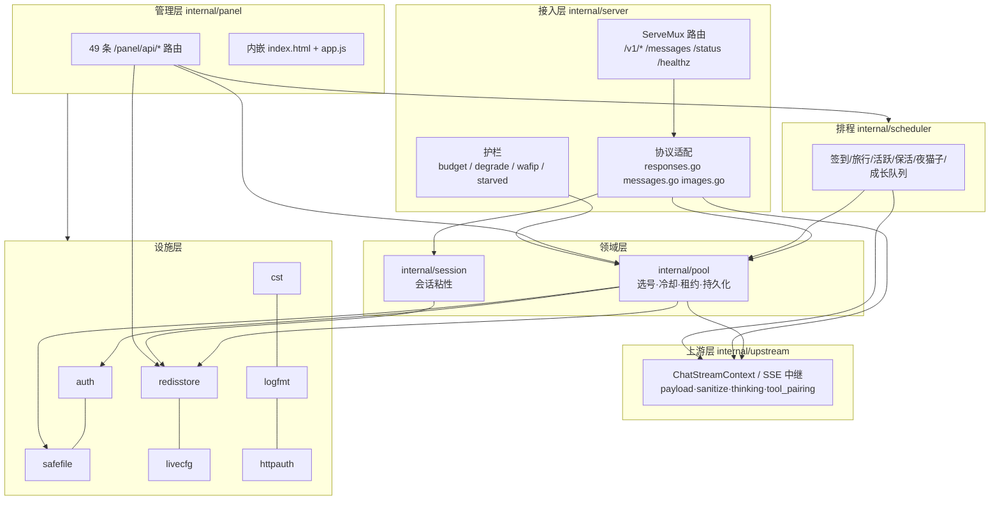

# 系统分层架构

WorkBuddy2API 是**单进程 Go 二进制**：一个 HTTP 服务同时对客户端提供 OpenAI/Anthropic 兼容协议，对上游转发到 CodeBuddy 非公开接口，并内嵌一个管理面板。没有前端构建步骤、没有数据库、没有消息队列。

## 分层视图

（Mermaid 渲染为 ASCII 时仍能读出：接入层 → 领域层（pool/session）→ 上游层；设施层被领域的持久化与热配置复用；panel/scheduler 是旁挂的驱动方。）

## 依赖方向（实证，由 import 边统计得出）

| 包 | 依赖的 internal 包 | 说明 |
|---|---|---|
| `internal/upstream` | auth, cst, logfmt, loginsite, session, safefile | 上游协议 + 出站身份；不依赖 pool（避免循环） |
| `internal/pool` | auth, cst, logfmt, safefile | 只管账号状态；上游倍率通过 `SetModelRateOf` 回调注入 |
| `internal/session` | redisstore | 粘性绑定持久化 |
| `internal/scheduler` | auth, balance, cst, credithist, logfmt, pool, session, upstream | 定时任务同时驱动 pool 与 upstream |
| `internal/server` | auth, cst, httpauth, livecfg, logfmt, pool, prompt, redisstore, reqlog, session, upstream, usage | 唯一网关入口 |
| `internal/panel` | auth, balance, credithist, httpauth, livecfg, logfmt, loginsite, pool, reqlog, scheduler, session, upstream, usage | 管理面，只依赖接口不反向被依赖 |
| `cmd/server` | 上述全部 + alert | 唯一装配点 |

关键约束：**pool 不 import upstream**（`internal/pool/pool.go:78-85` 的 `modelRateOf` 注释写明避免循环依赖与分层破坏），**scheduler 不 import panel**（成长队列执行体由 `sch.SetGrowthRunner(pn.RunGrowthQueueNow)` 注入，`cmd/server/main.go:392-393`）。

## 进程装配顺序（`cmd/server/main.go:58-508`）

1. `Load(config)` → 缺失则 `WriteDefault` 生成含随机 api_key 的配置（`main.go:62-77`）。
2. `auth.LoadDir(cfg.AuthDir)` 读 `auths/*.json`（`main.go:79`）。
3. `redisstore.New` → 未配置/连不上即 Noop（`main.go:93`）。
4. `pool.New(stateFile)` → `RestoreFromSnapshot`（Redis 快照择新）→ `SyncToDir(auths)`（`main.go:95-108`）。
5. 一串 `Set*` 注入熔断/在途/降权/保底/权重/优先级（`main.go:110-121`）。
6. `session.New` + `LoadFromStore` + `StartGC`（`main.go:125-140`）。
7. `upstream.New()` + DNS/超时/UA/脱敏/global base/模型目录路径（`main.go:143-216`）。
8. `balance.New`、`scheduler.New`（`main.go:213-292`）。
9. `livecfg.New`、`usage.New`、`reqlog.New`、`credithist.New`（`main.go:305-345`）。
10. `panel.New`（`main.go:351-390`），随后 `server.NewHandler`（`main.go:399-436`）。
11. `StartTaskJobs` / `go sch.Run` / 余额刷新 / 补领清扫 / 告警（`main.go:443-469`）。
12. `warmModelRates` 异步预热倍率表（`main.go:476`、实现 `main.go:520-560`）。
13. `http.Server{ReadHeaderTimeout:30s, ReadTimeout:cfg, IdleTimeout:120s}`，无全局 `WriteTimeout`（`main.go:481-499`）。

## 目录职责

| 目录 | 行数 | 职责 |
|---|---|---|
| `cmd/server` | 3341 | 装配 + 配置加载/校验/热保存 + 启动横幅 |
| `cmd/login` `cmd/signin` `cmd/credit` `cmd/trial` | 1330 | 一次性 CLI 工具（OAuth 登录、批量签到、积分查询、trial 领取） |
| `internal/server` | 17898 | 网关 HTTP 入口与协议适配、错误策略、护栏 |
| `internal/upstream` | 22258 | 上游协议、SSE、改写管线、模型目录、账号生命周期端点 |
| `internal/panel` | 15263 | 管理面 API + 内嵌前端（app.js 4669 行 / index.html 1615 行） |
| `internal/pool` | 9972 | 账号池状态机 |
| `internal/scheduler` | 5990 | 定时任务 |
| 其余 13 个小包 | 约 6000 | 各司一职的设施（见 04-服务层/类型系统文档） |

## 三个"闸"的分布（同一开关在多层各自校验）

| 开关 | 第一道 | 第二道 | 第三道 |
|---|---|---|---|
| `global.enabled` | `upstream.GlobalEnabled`（`internal/upstream/client.go:951-953`） | `auth.SetGlobalEnabled`（`cmd/server/main.go:210`） | `handler.cfg.GlobalEnabled` 不列 `global:` 模型（`cmd/server/main.go:418`） |
| `api_key` | 静态字段（`handler.Config.APIKey`） | `livecfg` 热快照优先（`internal/server/handler.go:106-115`） | 面板保存整体替换快照（`cmd/server/main.go:693-700`） |
| 积分保底 | `pool.creditFloor` 本地台账 | `pool.modelRateOf` 目录倍率兜底 | 全池触底 → 选号 nil → 503（`internal/pool/pick.go:275-307`） |

## 相关文档

- 技术选型与版本 → 详见 [技术栈与中间件](技术栈与中间件.md)
- 构建/部署/端口 → 详见 [部署与运行架构](部署与运行架构.md)
- 请求进出的完整路径 → 详见 [../03-核心数据业务流/聊天补全全链路.md](../03-核心数据业务流/聊天补全全链路.md)
