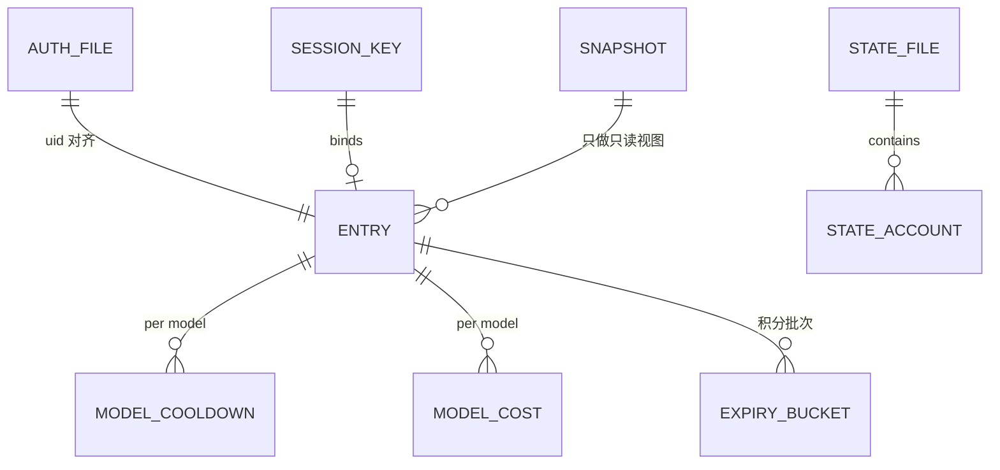

# 类型系统与数据模型

Go 项目没有前端 Store，对应物是**池内状态**（`pool.entry`）+ **落盘结构**（`state.json`）+ **热配置快照**（`livecfg.Snapshot`）。三者字段一一对应但用途不同。

## 实体关系

Mermaid 的实体名是概念名；Go 类型名见下表。

## 核心类型

| 类型 | 位置 | 用途 | 关键字段 |
|---|---|---|---|
| `auth.Auth` | `internal/auth/auth.go:24-45` | 账号凭证（`auths/workbuddy-*.json` 的内存形态） | `AccessToken`、`RefreshToken`、`ExpiresAt`(Unix 秒)、`Domain`、`realm`(未导出)、`UID`、`EnterpriseID`、`Nickname`、`DeviceToken`、`FilePath`(不落盘)、`mu` |
| `pool.Pool` | `internal/pool/pool.go:15-106` | 全局池状态机 | `mu`、`byUID`、`stateFp`、`dirty`、`store` + 20 多个注入参数 |
| `pool.entry` | `internal/pool/entry.go:229-325` | 单账号运行态 | `credits`、`creditsRemainder`、`until`、`disabled`、`paused`、`hold`、`lastUsed`、`usedSeq`、`breakerUntil`、`softStreak`、`modelCooldowns`、`modelOff`、`sessionDeadFails`、`consecutiveFails`、`degradeUntil`、`modelCost`、`inFlight` |
| `pool.Status` | `internal/pool/entry.go:79-180` | 对外只读视图（`/status` 与面板） | 见下节 |
| `pool.stateFile` | `internal/pool/entry.go:628-630` | `state.json` 根结构 | `Accounts map[string]stateAccount` |
| `pool.stateAccount` | `internal/pool/entry.go:532-625` | 单账号落盘 | 含 `breaker_until`/`degrade_until` 指针、`model_cooldowns`、`model_off`、`model_costs`、`credits_expiry_buckets` |
| `pool.CoolKind` | `internal/pool/entry.go:17-22` | 冷却种类枚举 | `CoolHard` / `CoolSoft` |
| `pool.ModelCostStatus` | `internal/pool/entry.go:167-176` | 每模型实测成本台账行 | `Model`、`CostPer1K`、`LastSeen`、`Samples`；**tier 不落字段**（≤0 即 tier0、>0 即 tier2、无观测即 tier1，避免双表示漂移） |
| `pool.RateLimitedModel` | `internal/pool/entry.go:178+` | 每模型限流台账行 | `Model`、`Kind`（`rate_limit` / `model_unavailable`） |
| `pool.ExpiryBucket` | `internal/pool/entry.go:72-77` | 积分到期批次（按自然日聚合） | `Date`、`ExpiresAt`、`Remain` |
| `pool.RealmHealth` | `internal/pool/state.go:587-651` | 按域健康统计（现算不存） | `Total`、`Healthy`、`Cooling`、`Disabled`、`Paused`、`InFlightFull`、`Breaker`、`Degraded`、`ManualDisabled`、`ModelCooled`、`InFlight` |
| `pool.ModelBlockStatus` | `internal/pool/cooldown.go:418+` | 模型级阻塞快照 | `Blocked`、`Count`、`Reason`、`Until` |
| `pool.TokenUsage` / `TokenUsageDelta` | `internal/pool/entry.go:35-55` | 每账号累计 token / 单次增量 | — |
| `pool.CreditsSnapshot` | `internal/pool/cooldown.go:72+` | 一次余额查询的完整快照（含批次） | — |
| `upstream.ErrKind` | `internal/upstream/client.go:29-50` | 错误分类枚举（17 值） | 见下节 |
| `upstream.Error` | `internal/upstream/client.go:92-101` | 分类后的错误信封 | `Kind`、`Status`、`Msg`、`RetryAfter` |
| `upstream.Client` | `internal/upstream/client.go:854-890` | 上游客户端（无状态但有缓存） | `HTTP`、`ChatHTTP`、`ChatBaseCN`、`BillingBaseCN`、`WebBaseCN`、`ChatBaseGlobal`、`BillingBaseGlobal`、`GlobalEnabled`、`DeviceToken*`、`SanitizeFingerprints`、`SanitizeBrandScope`、`creditObserver` |
| `session.Router` | `internal/session/session.go:32-66` | 粘性路由 | `Config{TTL, GCInterval, Store, Available, AvailableForModel}` + `entries` |
| `livecfg.Snapshot` | `internal/livecfg/livecfg.go:18-30` | 运行期可变配置快照 | `APIKey`、`SoftCooldown`、`SanitizeFingerprints`、`RecordClientInfo`、`HiddenModels`、`ModelAliases`、`ModelFallback` |
| `server.Config` | `internal/server/handler.go:33-140` | handler 依赖注入 | `Pool`、`Upstream`、`Session`、`Panel`、`Live`、`Usage`、`RequestLog`、`Tasks`、`Audit`、`Budget*` |
| `server.Handler` | `internal/server/handler.go:159-170` | 网关实例 | `cfg`、`mux`、`degrade`、`wafIP`、`taskRunning`、`budget` |
| `panel.Config` / `panel.Panel` | `internal/panel/panel.go:27-124` | 面板依赖 + 状态 | `Pool`、`Usage`、`RequestLog`、`Upstream`、`Scheduler`、`Balance`、`CreditHistory`、`Live`、`growthConc` |
| `scheduler.Config` | `internal/scheduler/scheduler.go:28-86` | 排程配置 | 6 组 `*Hours` + 8 个 `*Disabled` + `JitterMinutes` + `AccountSpread*` + `RunStampFile` |
| `usage.Delta` / `usage.Window` / `usage.Snapshot` | `internal/usage/usage.go:44-100`、`:527`、`:585` | 用量桶与查询 | `Req/Err/PT/CT/TT/CH/CM/LatMs/LatN/TPS/TPSN/CR/CRN/CRT` |
| `balance.Series` | `internal/balance/balance.go:445+` | 每账号余额曲线 | `Points`、`Current`、`Min`、`Max`、`Change`、`Daily`、`Full`、`Realm` |
| `credithist.Entry` | `internal/credithist/credithist.go` | 积分变动流水条目 | uid、时间、delta、余额 |
| `reqlog.Event` | `internal/reqlog/reqlog.go:58-100` | 脱敏请求记录 | `Time`、`RequestID`、`Path`、`Account`("昵称(uid8)")、`Model`、`Status`、`OK`、`Outcome`、`DurationMs`、`TTFBMs`、`Attempts`、token 三项、`Credit`、`HasCredit`、`ClientIP`、`UserAgent` |
| `reqlog.Filter` | `internal/reqlog/reqlog.go:89-100` | 归档查询过滤 | 字符串字段大小写不敏感包含 + `From/To` 闭区间 |
| `alert.Config` / `alert.Health` | `internal/alert/alert.go:19-77`、`cmd/server/wiring.go:33-40` | 告警阈值与健康快照 | interval/timeout/forTicks/clearTicks/startupGrace + `Total/Healthy/Cooling/Disabled/Breaker/Degraded/InFlight` |

## `pool.Status` 字段速查（`/status` 与面板直接消费）

| 分组 | 字段 |
|---|---|
| 身份 | `uid`、`nickname`、`realm`、`enterprise`、`api_key` |
| 余额 | `credits`、`credits_total`、`credits_expiring`、`credits_earliest_expiry`、`credits_earliest_remaining`、`credits_expiry_buckets`、`reserve_blocked` |
| 状态 | `disabled`、`disabled_reason`、`disabled_at`、`paused`、`hold`、`cooling`、`cool_kind`、`cool_remaining_sec`、`until`、`reason`、`soft_streak`、`degrade_until` |
| 运行态 | `in_flight`、`breaker_fails`、`breaker_until`、`consecutive_fails` |
| 会话 | `session_dead_fails` |
| 路由偏好 | `priority`、`share` |
| 台账 | `rate_limited_models`、`model_costs`、`token_usage`、`success_count`、`err_total`、`last_success`、`last_err`、`checkin_done` |

**零值语义明确**：`consecutive_fails`（`entry.go:156`）与 `session_dead_fails`（`entry.go:90`）**不带** `omitempty`——零值缺失会让人误以为"没记录"。

## `upstream.ErrKind` 十七值

| 值 | 触发 | 罚号？ | 轮转？ |
|---|---|---|---|
| `ErrNone` | 成功 | — | — |
| `ErrHardCredit` | 402，或 429+`14018`，或 body 命中 hardMarkers | 硬冷却到次日 04:00 | 是 |
| `ErrSoftRate` | 429 兜底、限流文案、6004/14003 | 软冷却（模型级或账号级） | 是 |
| `ErrSessionDead` | 401+12153、网关 401、session dead 文案 | 3 次才禁 | 是 |
| `ErrNotFound` | 404 | 60s 软冷却 | 是 |
| `ErrServer` | 5xx | `NoteError` 熔断计数 | 是 |
| `ErrContentBlocked` | 400 + 审核文案 | 否 | passthrough 首遇降级重试，否则终止 |
| `ErrBadParams` | 11101 / Unmarshal chat params failed | 否 | 否（400 透传） |
| `ErrAccountFault` | 11140 request illegal、14017 trial not activated | 视文案（`11-128` 软冷却、request illegal 直接禁） | 是 |
| `ErrModelBlocked` | 11102、11158、14401 | (号,模型) 负缓存 | 换号/换模型 |
| `ErrWafBlock` | 403 无业务信封 | 软冷却（60s±抖动） | 是（IP 级激活时终止） |
| `ErrPromptTooLong` | 11115 | 否 | 否（400 透传） |
| `ErrImageInvalid` | 11135 invalid_image_data | 否 | 否（400 透传） |
| `ErrModelParamInvalid` | 11133 参数被供应商拒绝 | 否 | 否（400 透传） |
| `ErrClient` | 其他 4xx / 业务错误 | `NoteFailures`（连败降权） | 是 |
| `ErrUpstreamBusy` | 6021 queue.full | 否 | 否（503 + Retry-After） |
| `ErrToolMismatch` | 11148 | 否 | 否（400 透传） |

判定顺序（严→宽）见 `internal/upstream/client.go:611-757`：11102 → 402 → sessionDead → accountFault → 429+14018 → 6021 → 429 → hardMarkers → softRateMarkers → 11115 → 11148 → 404 → 5xx → 403 无信封 → 401 无信封 → 11135 → 11133 → 内容策略 → 11101 → `ErrClient`。

## 枚举与常量

| 常量组 | 值 | 位置 |
|---|---|---|
| `reqlog.Outcome*` | `success` / `http_error` / `stream_error` / `interrupted` | `internal/reqlog/reqlog.go:41-46` |
| `plan.PlanKind` | `free` / `trial` / `activity` / `standard` / `unknown` | `internal/pool/plan.go:13-22,45` |
| 冷却原因前缀 | `rate_limit` / `model_unavailable` | `internal/pool/state.go`（`rateLimitedModelsLocked`） |
| 任务状态 | `pending` / `running` / `finished` / `interrupted` / `error`（作业）；`pending` / `running` / `done` / `skipped` / `error`（队列） | `internal/panel/taskjobs.go:39-55`、`taskcenter.go:162-172` |
| `loginsite` 码表 | 继续轮询 `11217`/`12151`；终态 `12005`/`11212`/`11216` | `internal/loginsite/loginsite.go:139-166` |
| `session_sticky` 默认 | TTL 30m、GC 5m | `internal/session/session.go:56-66` |

## 数据模型的三条约束

1. **凭证文件双形态**：嵌套形（`auth.accessToken`）与扁平形（顶层 `accessToken`）都必须能解析；写回**统一写嵌套形**（`internal/auth/auth.go:351`、`:449-467`）。
2. **运行态不落盘**：`inFlight`、`lastUsed`、`usedSeq`、`exploreLast` 都是运行态——重启归零，代价是每个仍冻结的 (域,模型) 多至 1 次即时重探。
3. **指针表示"可缺省"**：`stateAccount` 里 `breaker_until` / `degrade_until` 用 `*time.Time`——区分"从未设置"与"设为零值"。

## 相关文档

- 状态怎么变、什么时候落盘 → 详见 [../03-核心数据业务流/账号池选号与冷却.md](../03-核心数据业务流/账号池选号与冷却.md)
- 类型对应的 API 契约 → 详见 [服务层与IPC通信.md](服务层与IPC通信.md)
